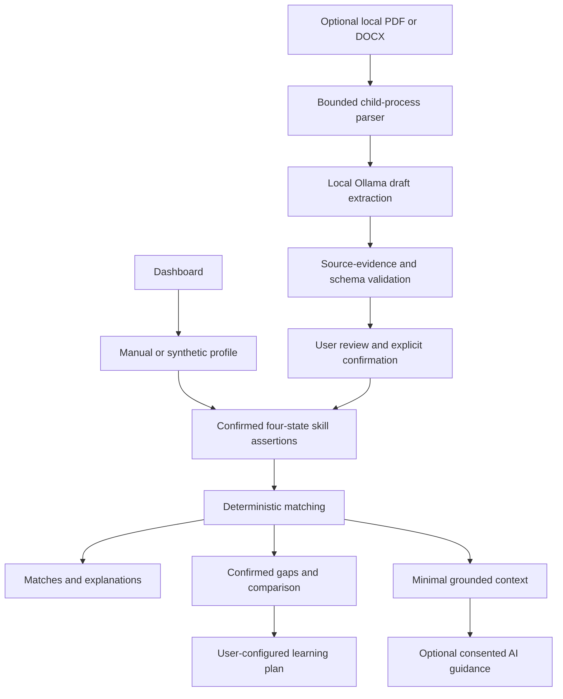

# FuturePath Architecture

## Scope and authoritative source

This document describes approved V3 RC2 commit `20fefb588189712de1132d91e0560a9841a46c21`. The application remains a Python + Streamlit modular monolith. The submission branch adds documentation only; it does not change the runtime, fixtures, matching arithmetic or deployment configuration.

The [original Manifest](../FUTUREPATH_V3_RC2_MANIFEST.json) and [release contract](../PUBLIC_RELEASE.md) remain authoritative for the exact 42-file runtime tree.

## User journey and data flow

AI advice has no write path into the score or ranking. Resume suggestions enter the profile only through explicit user confirmation. Public mode does not expose the resume uploader and the shipped Replit commands disable AI.

## Module boundaries

| Module | Contract |
|---|---|
| `domain/models.py`, `domain/career_profile.py` | Typed skill states and confirmed profile identity |
| `fixtures/` | Synthetic sample profiles and fictional occupation requirements, with integrity checks |
| `services/profile_intake.py` | Validate the user's four-state assertions |
| `services/matching.py` | Partition requirements, calculate coverage and rank complete results |
| `services/synthetic_journey.py` | Deterministic learning/practice journey |
| `services/ai_guidance.py` | Grounded Advisor, Coach, Roadmap and bounded contextual Chat |
| `services/llm/provider.py` | Vendor-neutral request, response, usage and sanitized failure types |
| `services/llm/ollama.py` | Local model discovery, bounded structured requests and safe failures |
| `services/llm/runpod_glm.py` | Fixed competition endpoint/model, bounded non-streaming Chat Completions |
| `services/ai_runtime.py`, `services/local_ai.py` | Provider selection, consent and separate local/public policies |
| `services/ai_budget.py` | Atomic shared cloud request, cost reservation and concurrency checks |
| `services/resume_parsing.py` | Bounded document validation and child-process extraction |
| `services/resume_profile.py` | Minimized extraction context, quote validation and confirmed skill transfer |
| `ui/`, `app.py` | Session-only workflow and safe English presentation |
| `deployment/public_package.py` | Immutable package membership, sizes, hashes and control-file validation |

## Deterministic authority

Known Present, Known Absent, Unknown and Not Reported are distinct. Only roles whose requirements are fully reported as present/absent receive complete `100 * present / required` coverage and a rank. Confirmed absences are actionable gaps; uncertainty is not absence. Evidence review and practice progress do not silently create proficiency.

Models receive approved synthetic role requirements and calculated results, never authority to alter them. Schema/reference/English-output validation reduces unsupported content but cannot establish factual truth. No live labour-market retrieval, salary forecasting or autonomous qualification verification exists.

## AI trust boundaries

Local mode defaults to Ollama, accepts literal loopback client URLs and uses installed models only. Native model discovery and structured output are bounded; the UI uses non-streaming calls and graceful fallback. An existing wildcard daemon listener must be corrected by the operator before private-document use; client URL validation does not restrict server binding.

RunPod is a separate explicit cloud option. It requires consent, a server-side key and reachable shared TLS Redis accounting. Default caps are 512 output tokens, 8,000 input bytes, USD 0.10 estimated per UTC day, 10 daily requests, 3 daily session requests and shared concurrency 1. SDK retries are disabled; at most one explicit unsupported-parameter compatibility retry remains. Retries and missing usage retain conservative reservations.

Redis checks must be shared by all replicas. A process-local counter is not Autoscale-wide enforcement. A provider billing cap, real shared Redis and live integrated behaviour are not verified by mocks or the owner's single endpoint smoke. The approved public configuration remains disabled.

## Resume, privacy and session isolation

PDF/DOCX processing validates signatures and archive structure, limits uploads/text/pages and uses a child parser with a 12-second parent deadline and 512 MB memory ceiling. Linux also applies CPU limits. This is resource isolation, not a malware sandbox or a complete guarantee against hostile documents.

Local extraction minimizes common contact details, treats embedded instructions as untrusted text, validates retained claims against source quotes and approved skill vocabulary, and requires explicit confirmation. Unconfirmed skills stay suggestions; background claims do not enter matching. No cloud-CV fallback is implemented.

Application code intentionally avoids persisting raw documents or logging prompts/content. Session state contains the active user's data; no shared resume cache is used. Clearing state cannot guarantee erasure from framework buffers, swap, model memory or host logs. Session isolation tests do not establish host-level confidentiality or independent-browser production isolation.

## Release tree versus submission repository

The immutable runtime consists of 42 approved files, including its original Manifest. The additional repository files are:

- `README.md`
- `docs/architecture.md`
- `submission/README.md`
- `.gitignore`

They are documentation/local hygiene, outside the original Manifest. The strict verifier must reject the expanded root. Verification and any separately authorized deployment must use a clean export or a fresh checkout of the exact approved RC2 commit. Never regenerate that Manifest to hide extra documentation or relax its membership policy.

Replit uses Python 3.12 and `.venv/bin/python`, with `requirements-public.lock`, no root `requirements.txt`, and public AI/CV disabled. Canonical LF for `.replit` and `.gitattributes` is already part of RC2. New Linux Publishing, exact deployed provenance, WebSockets and production logs remain external gates.

See [setup and evidence](../README.md) and [submission status](../submission/README.md). No new infrastructure, deployment, paid request or scoring change is part of this branch.
